<!-- profilescape:start -->

<picture>
  <source media="(prefers-color-scheme: dark)" srcset="https://raw.githubusercontent.com/sai-kumar-mupparthi/sai-kumar-mupparthi/profilescape-output/hero-dark.svg" />
  
</picture>

<a href="https://github.com/sai-kumar-mupparthi">
<picture>
  <source media="(prefers-color-scheme: dark)" srcset="https://raw.githubusercontent.com/sai-kumar-mupparthi/sai-kumar-mupparthi/profilescape-output/social-github-dark.svg" />
  
</picture>
</a>
<a href="https://www.linkedin.com/in/sai-kumar-mupp">
<picture>
  <source media="(prefers-color-scheme: dark)" srcset="https://raw.githubusercontent.com/sai-kumar-mupparthi/sai-kumar-mupparthi/profilescape-output/social-linkedin-dark.svg" />
  
</picture>
</a>
<a href="https://sai-kumar-mupparthi-portfolio.netlify.app">
<picture>
  <source media="(prefers-color-scheme: dark)" srcset="https://raw.githubusercontent.com/sai-kumar-mupparthi/sai-kumar-mupparthi/profilescape-output/social-website-dark.svg" />
  
</picture>
</a>

<picture>
  <source media="(prefers-color-scheme: dark)" srcset="https://raw.githubusercontent.com/sai-kumar-mupparthi/sai-kumar-mupparthi/profilescape-output/stats-dark.svg" />
  
</picture>

<picture>
  <source media="(prefers-color-scheme: dark)" srcset="https://raw.githubusercontent.com/sai-kumar-mupparthi/sai-kumar-mupparthi/profilescape-output/3d-dark.svg" />
  
</picture>

<picture>
  <source media="(prefers-color-scheme: dark)" srcset="https://raw.githubusercontent.com/sai-kumar-mupparthi/sai-kumar-mupparthi/profilescape-output/languages-dark.svg" />
  
</picture>

<table>
  <tr>
    <td width="50%">
<a href="https://github.com/sai-kumar-mupparthi/clinical-agentic-ai">
<picture>
  <source media="(prefers-color-scheme: dark)" srcset="https://raw.githubusercontent.com/sai-kumar-mupparthi/sai-kumar-mupparthi/profilescape-output/repo-sai-kumar-mupparthi-clinical-agentic-ai-dark.svg" />
  
</picture>
</a>
    </td>
    <td width="50%">
<a href="https://github.com/sai-kumar-mupparthi/healthcare-rag-assistant">
<picture>
  <source media="(prefers-color-scheme: dark)" srcset="https://raw.githubusercontent.com/sai-kumar-mupparthi/sai-kumar-mupparthi/profilescape-output/repo-sai-kumar-mupparthi-healthcare-rag-assistant-dark.svg" />
  
</picture>
</a>
    </td>
  </tr>
</table>

<table>
  <tr>
    <td width="50%">
<a href="https://github.com/sai-kumar-mupparthi/patient-readmission-prediction">
<picture>
  <source media="(prefers-color-scheme: dark)" srcset="https://raw.githubusercontent.com/sai-kumar-mupparthi/sai-kumar-mupparthi/profilescape-output/repo-sai-kumar-mupparthi-patient-readmission-prediction-dark.svg" />
  
</picture>
</a>
    </td>
    <td width="50%">
<a href="https://github.com/sai-kumar-mupparthi/clinical-nlp-pipeline">
<picture>
  <source media="(prefers-color-scheme: dark)" srcset="https://raw.githubusercontent.com/sai-kumar-mupparthi/sai-kumar-mupparthi/profilescape-output/repo-sai-kumar-mupparthi-clinical-nlp-pipeline-dark.svg" />
  
</picture>
</a>
    </td>
  </tr>
</table>

<table>
  <tr>
    <td width="50%">
<a href="https://github.com/sai-kumar-mupparthi/fraud-detection-credit-risk">
<picture>
  <source media="(prefers-color-scheme: dark)" srcset="https://raw.githubusercontent.com/sai-kumar-mupparthi/sai-kumar-mupparthi/profilescape-output/repo-sai-kumar-mupparthi-fraud-detection-credit-risk-dark.svg" />
  
</picture>
</a>
    </td>
    <td width="50%">
<a href="https://github.com/sai-kumar-mupparthi/ecommerce-recommendations">
<picture>
  <source media="(prefers-color-scheme: dark)" srcset="https://raw.githubusercontent.com/sai-kumar-mupparthi/sai-kumar-mupparthi/profilescape-output/repo-sai-kumar-mupparthi-ecommerce-recommendations-dark.svg" />
  
</picture>
</a>
    </td>
  </tr>
</table>

<picture>
  <source media="(prefers-color-scheme: dark)" srcset="https://raw.githubusercontent.com/sai-kumar-mupparthi/sai-kumar-mupparthi/profilescape-output/stack-dark.svg" />
  
</picture>

<!-- profilescape:end -->
